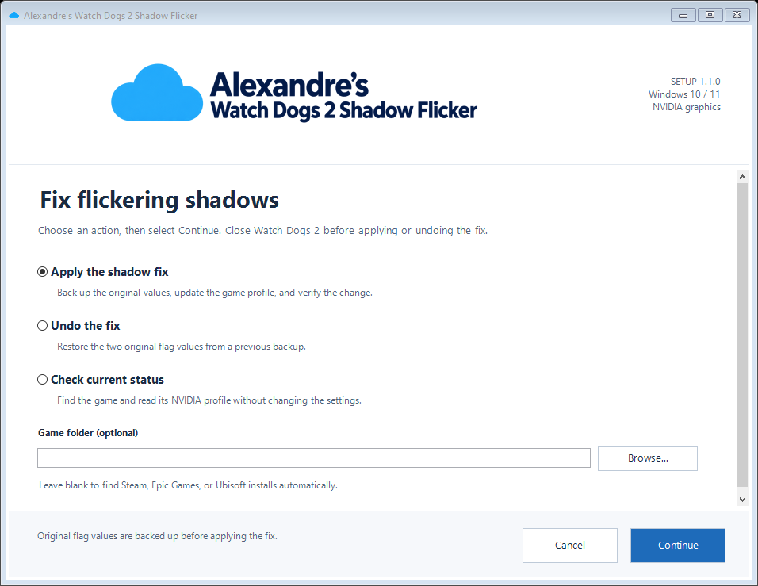

# Watch Dogs 2 Shadow Flicker Fix

A Windows setup wizard and standalone PowerShell script that apply a per-game NVIDIA driver-profile workaround for flickering shadows and sky in **Watch Dogs 2**.

## Windows installer

[Download the Windows 10 / 11 installer ZIP (v1.1.0)](https://github.com/APouzi/WatchDogs2-Shadow-flicker-fix/releases/download/v1.1.0/Alexandres-WatchDogs2-Shadow-Flicker-v1.1.0-win-x64.zip)

1. Close Watch Dogs 2 and extract the ZIP.
2. Double-click `Alexandres-WatchDogs2-Shadow-Flicker-Setup.exe` and approve the Windows administrator prompt.
3. Choose **Apply the shadow fix**, **Undo the fix**, or **Check current status**, then select **Continue**.
4. Wait for the progress and verified result, then select **Finish**.

The wizard uses the same backup and install detection as the script. Cancel stops at a safe checkpoint before driver changes begin; it is disabled while the values are saved and verified. The executable is unsigned, so Windows displays an unknown publisher. The ZIP includes checksum information and a short guide.



See [installer details and build instructions](docs/installer.md). The original script remains available below.

## Requirements

- 64-bit Windows 10 or Windows 11 with NVIDIA graphics.
- .NET Framework 4.8 and the built-in Windows PowerShell 5.1. Starting from PowerShell 7 automatically uses the Windows PowerShell helper.
- Internet access on first use to download the pinned release of the community tool [NVIDIA Profile Inspector 3.0.2.1](https://github.com/Orbmu2k/nvidiaProfileInspector/releases/tag/v3.0.2.1). The archive and required extracted files are verified against pinned SHA256 checksums.

## Use

Save `WatchDogs2-FlickerFix.ps1` anywhere, close Watch Dogs 2, and run this from PowerShell. Replace the script path with its saved location:

```powershell
powershell.exe -NoProfile -ExecutionPolicy Bypass -File "C:\Path\WatchDogs2-FlickerFix.ps1"
```

Approve the Windows administrator prompt, then start the game normally. The execution-policy option applies only to this PowerShell process; it does not change your permanent execution policy.

The script can run from any folder. It checks Steam library catalogs, Epic manifests, Ubisoft install registry entries, Windows uninstall records, and common game folders. Each result is validated by finding `WatchDogs2.exe`.

Check status without changing NVIDIA settings:

```powershell
powershell.exe -NoProfile -ExecutionPolicy Bypass -File "C:\Path\WatchDogs2-FlickerFix.ps1" -Action Status
```

Undo the change after closing the game:

```powershell
powershell.exe -NoProfile -ExecutionPolicy Bypass -File "C:\Path\WatchDogs2-FlickerFix.ps1" -Action Restore
```

If launcher records are missing or the game was manually moved, append `-GamePath "D:\My Games\Watch_Dogs2"`. This also accepts the `bin` folder or the full path to `WatchDogs2.exe`. Restore remains available after uninstalling the game.

## Changes and backup

Only these two flags in the existing **Watch Dogs 2** NVIDIA profile are changed:

| Setting ID | Applied value |
| --- | --- |
| `0x00A4F311` | `0xA2B53761` |
| `0x00FC7620` | `0x00000001` |

The first original flag values, profile snapshots, dependency cache, and `LastRun.log` are stored in `%LOCALAPPDATA%\WatchDogs2FlickerFix`. Applying an already-present fix performs no driver writes. Restore uses the saved original flag values and preserves other game-profile settings. Keep this folder if you want to undo the fix later.

If the flags were applied separately before using this script and there is no original backup, the script reports that fact and refuses to guess previous values during Restore.

The script does not modify game files, image-quality settings, anti-cheat, multiplayer settings, the global NVIDIA profile, or other game profiles. Apply and Restore require administrator access. It will not close a running game for you.

For offline use, `-ToolPath` can point to an extracted official Profile Inspector 3.0.2.1 executable with its original `Reference.xml` beside it. Both checksums must match. `-StateDirectory` can override the backup/cache directory; keep using the same directory for Restore.

## Verification

The workaround was confirmed by the user on an **RTX 3080 with NVIDIA driver 610.88**. Compatibility and effectiveness can vary by GPU and driver.

Windows PowerShell 5.1 parsing, a read-only live status check, a fresh dependency download/checksum check, and PowerShell 7 helper compatibility passed locally. The 20 fixture checks cover flag parsing, idempotent writes, targeted restore, partial-write recovery helpers, malformed backup rejection, checksum rejection, and explicit installation paths. Launcher discovery also received independent mocked checks for Steam, Epic, and Ubisoft. Local checks ran on Windows 10 Home 22H2; separate Windows 11 and Epic/Ubisoft gameplay were not tested.

Run the original fixture checks from the repository root; they use mocked settings and do not change NVIDIA profiles. The installer adds 32 progress/cancellation checks, 20 UI checks, and 35 package checks described in the build guide:

```powershell
powershell.exe -NoProfile -ExecutionPolicy Bypass -File .\tests\Test-WatchDogs2-FlickerFix.ps1
```

## Sources

- [Original shader-profile workaround](https://www.reddit.com/r/watch_dogs/comments/1d0wa4r/nvidiawatch_dogs_2_skyboxshadow_flicker_fix/)
- [NVIDIA Profile Inspector project](https://github.com/Orbmu2k/nvidiaProfileInspector)
